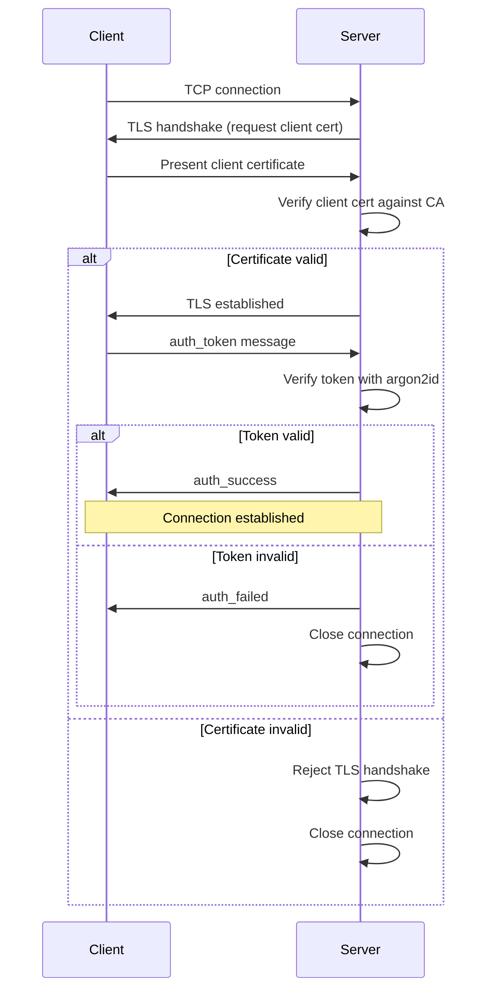

# Technical Design Document: Remote Monitoring Admin System

## Overview

### Purpose

This document specifies the technical design for a client-server remote monitoring and administration system for Linux environments. The system enables a single server administrator to monitor and control up to 3 Linux clients simultaneously over a LAN connection with secure TLS communication.

### Key Capabilities

- **Real-time Screen Streaming**: 5-10 FPS JPEG-compressed screen capture with adjustable resolution
- **Bidirectional File Transfer**: Chunked transfer with SHA-256 verification
- **Real-time Bidirectional Chat**: Text messaging between server and each client
- **Remote Input Control**: Block/unblock keyboard and mouse via xinput
- **Network Administration**: Domain blocking (/etc/hosts), ICMP echo control (sysctl)
- **Power Management**: Remote shutdown capability
- **Multi-Client Monitoring**: Dashboard showing status, metrics, and thumbnails of 3 clients
- **Security**: TLS encryption, argon2id authentication, privilege separation architecture
- **Audit Logging**: Comprehensive action logs on both server and client sides

### Technology Stack

- **Language**: Python 3.11+
- **Async Framework**: asyncio for concurrent connection management
- **UI Framework**: PyQt6 for server GUI, minimal PyQt6 for client system tray
- **Screen Capture**: mss library for X11 screen capture
- **Image Processing**: Pillow for JPEG compression and scaling
- **Cryptography**: cryptography library for TLS, argon2-cffi for authentication
- **System Monitoring**: psutil for CPU/RAM metrics
- **Network Protocol**: Custom JSON-based protocol over TCP/TLS with 4-byte length framing
- **Target Platform**: Linux with X11 (Wayland support limited)

## Architecture

### High-Level Architecture

```mermaid
graph TB
    subgraph Server["Server (Administrator Machine)"]
        ServerUI["PyQt6 UI<br/>Main Window"]
        ServerCore["Server Core<br/>asyncio event loop"]
        ConnMgr["Connection Manager<br/>Max 3 clients"]
        Logger["Action Logger"]
        FileHandler["File Transfer Handler"]
    end
    
    subgraph Client1["Client 1 (Linux Machine)"]
        ClientAgent1["Client Agent<br/>asyncio event loop"]
        ClientUI1["Minimal UI<br/>Tray + Overlays"]
        ScreenCap1["Screen Capture<br/>mss + Pillow"]
        Helper1["Privileged Helper<br/>Separate Process"]
        Watchdog1["Watchdog<br/>Safety Monitor"]
    end
    
    subgraph Client2["Client 2 (Linux Machine)"]
        ClientAgent2["Client Agent"]
        ClientUI2["Minimal UI"]
        ScreenCap2["Screen Capture"]
        Helper2["Privileged Helper"]
        Watchdog2["Watchdog"]
    end
    
    subgraph Client3["Client 3 (Linux Machine)"]
        ClientAgent3["Client Agent"]
        ClientUI3["Minimal UI"]
        ScreenCap3["Screen Capture"]
        Helper3["Privileged Helper"]
        Watchdog3["Watchdog"]
    end
    
    ServerCore <-->|TLS Connection| ClientAgent1
    ServerCore <-->|TLS Connection| ClientAgent2
    ServerCore <-->|TLS Connection| ClientAgent3
    
    ServerUI <--> ServerCore
    ServerCore <--> ConnMgr
    ServerCore <--> Logger
    ServerCore <--> FileHandler
    
    ClientAgent1 <--> ClientUI1
    ClientAgent1 <--> ScreenCap1
    ClientAgent1 <-->|Unix Socket| Helper1
    ClientAgent1 <--> Watchdog1
    
    style Server fill:#2c3e50
    style Client1 fill:#34495e
    style Client2 fill:#34495e
    style Client3 fill:#34495e
    style Helper1 fill:#e74c3c
    style Helper2 fill:#e74c3c
    style Helper3 fill:#e74c3c
```



### Deployment Architecture

```
Server Machine:
~/.config/remote-monitor/
├── server_config.json          # Server configuration (port, paths, limits)
├── certs/
│   ├── server.crt              # Server TLS certificate
│   ├── server.key              # Server private key
│   └── authorized_clients/     # Directory of authorized client certificates
│       ├── client1.crt
│       ├── client2.crt
│       └── client3.crt
└── logs/
    └── action_log_YYYYMMDD.txt # Daily action logs

/opt/remote-monitor/server/
├── main.py                     # Server entry point
├── ui.py                       # PyQt6 UI components
├── client_manager.py           # Connection management
├── logger.py                   # Action logging
└── file_handler.py             # File transfer logic

Client Machine:
~/.config/remote-monitor/
├── client_config.json          # Client configuration (server address, auth token)
├── certs/
│   ├── client.crt              # Client TLS certificate
│   ├── client.key              # Client private key
│   └── server.crt              # Trusted server certificate
└── logs/
    └── action_log_YYYYMMDD.txt # Daily action logs

/opt/remote-monitor/client/
├── main.py                     # Client entry point
├── agent.py                    # Network client logic
├── ui.py                       # Minimal UI (tray, overlays)
├── screen_capture.py           # Screen streaming
├── executors.py                # Command executors
└── watchdog.py                 # Safety watchdog

/opt/remote-monitor/helper/
├── privileged_helper.py        # Privileged operations subprocess
└── commands.py                 # Whitelisted command definitions

/opt/remote-monitor/common/
├── protocol.py                 # Protocol definitions
├── crypto.py                   # TLS and authentication utilities
└── utils.py                    # Shared utilities
```

## Components and Interfaces

### Server Components

#### Server Core (server/main.py)

**Responsibility**: Application entry point and main event loop coordinator.

**Key Classes**:
- `ServerApplication`: Main application class
  - Initializes configuration from `server_config.json`
  - Sets up TLS context with server certificates
  - Creates and starts asyncio event loop
  - Instantiates UI and ConnectionManager
  - Handles graceful shutdown

**Interfaces**:
- CLI: `python main.py [--config PATH] [--port PORT]`
- Exposes UI callbacks for user actions
- Communicates with ConnectionManager via async methods

#### Connection Manager (server/client_manager.py)

**Responsibility**: Manage TCP/TLS connections to up to 3 clients simultaneously.

**Key Classes**:
- `ConnectionManager`:
  - `async def start_server(host: str, port: int)`: Start TCP server
  - `async def handle_client(reader: StreamReader, writer: StreamWriter)`: Handle new connections
  - `async def authenticate_client(reader, writer) -> ClientSession | None`: Perform TLS handshake and token validation
  - `async def send_message(client_id: str, message: dict)`: Send protocol message to specific client
  - `async def broadcast_heartbeat()`: Send heartbeat to all connected clients every 3 seconds
  - `def get_connected_clients() -> list[ClientSession]`: Return list of active clients
  - `async def disconnect_client(client_id: str)`: Gracefully disconnect a client

- `ClientSession`:
  - Attributes: `client_id`, `hostname`, `ip_address`, `os_info`, `reader`, `writer`, `last_heartbeat`, `state`
  - `async def receive_message() -> dict | None`: Read and parse next protocol message
  - `async def send_command(command: str, payload: dict)`: Send command to this client
  - Methods for specific commands: `request_screenshot()`, `request_metrics()`, `send_chat()`, etc.

**State Management**:
- Maximum 3 concurrent client connections
- Each client has associated state: CONNECTING, AUTHENTICATED, ACTIVE, DISCONNECTED
- Thread-safe access to client list using asyncio locks

#### UI Manager (server/ui.py)

**Responsibility**: PyQt6 graphical user interface for server administrator.

**Key Classes**:
- `MainWindow(QMainWindow)`:
  - Left sidebar: ClientPanel showing 3 client slots
  - Main area: QTabWidget with tabs for different functions
  - Status bar showing connection count and system status
  
- `ClientPanel(QWidget)`:
  - 3 `ClientSlot` widgets arranged vertically
  - Each slot shows: hostname, IP, OS, connection status (green/gray)
  - Click to select active client (highlighted border)
  
- `ClientSlot(QFrame)`:
  - Displays: hostname, IP, CPU%, RAM%, 160x120px thumbnail
  - Updates metrics every 2 seconds, thumbnail every 5 seconds
  - Visual states: Connected (green), Disconnected (gray), Selected (blue border)
  
- Tab widgets:
  - `ScreenTab(QWidget)`: Display full screen stream, FPS counter, resolution selector
  - `ChatTab(QWidget)`: Chat history area (QTextEdit), input field, send button
  - `FilesTab(QWidget)`: Send/receive file buttons, transfer progress bars
  - `ControlTab(QWidget)`: Lock/unlock input buttons, shutdown button
  - `NetworkTab(QWidget)`: Domain blocklist management, ping control buttons
  - `LogTab(QWidget)`: Action log table with timestamp, client, action columns, export button

**UI Update Pattern**:
- UI runs in main Qt thread
- Network operations run in asyncio event loop in separate thread
- Communication via thread-safe queues and Qt signals
- Use `QMetaObject.invokeMethod` or custom signals to update UI from asyncio callbacks

#### Action Logger (server/logger.py)

**Responsibility**: Record all server actions for audit trail.

**Key Classes**:
- `ActionLogger`:
  - `log_event(client_hostname: str, action: str, description: str)`: Log an event
  - `get_recent_logs(count: int) -> list[LogEntry]`: Retrieve recent log entries
  - `filter_logs(client: str | None, action_type: str | None) -> list[LogEntry]`: Filter logs
  - `export_logs(filepath: str)`: Export logs to text file
  
- `LogEntry`:
  - Attributes: `timestamp`, `client_hostname`, `action_type`, `description`

**Log Format**:
```
[2024-01-15 14:23:45] [Cliente: lab-pc-01] [CONNECTION] Cliente conectado desde 192.168.1.101
[2024-01-15 14:24:02] [Cliente: lab-pc-01] [SCREEN_START] Streaming de pantalla iniciado a 1024x768
[2024-01-15 14:25:15] [Cliente: lab-pc-01] [INPUT_LOCK] Teclado y mouse bloqueados
```

**Storage**:
- Append-only file: `~/.config/remote-monitor/logs/action_log_YYYYMMDD.txt`
- New file created each day
- In-memory cache of last 500 entries for UI display

#### File Transfer Handler (server/file_handler.py)

**Responsibility**: Manage bidirectional file transfers with verification.

**Key Classes**:
- `FileTransferHandler`:
  - `async def send_file(client_id: str, filepath: str, progress_callback)`: Send file to client
  - `async def receive_file(client_id: str, save_path: str, progress_callback)`: Receive file from client
  
- `FileTransfer`:
  - Attributes: `file_id`, `filename`, `total_size`, `transferred_bytes`, `checksum`, `state`
  - `async def send_chunk() -> bytes`: Read next 64KB chunk
  - `async def receive_chunk(data: bytes)`: Write received chunk
  - `calculate_checksum() -> str`: Compute SHA-256 hash
  - `verify_checksum(expected: str) -> bool`: Verify integrity

**Transfer Protocol**:
1. Sender sends `file_init` message: `{type: "file_init", filename, size, checksum}`
2. Receiver responds `file_accept` or `file_reject`
3. Sender sends chunks: `{type: "file_chunk", file_id, chunk_num, data: base64}`
4. Receiver acknowledges each chunk: `{type: "file_chunk_ack", chunk_num}`
5. After all chunks, receiver computes checksum and sends: `{type: "file_complete", checksum}`
6. Sender verifies match and sends `file_verified` or `file_failed`

### Client Components

#### Client Agent (client/agent.py)

**Responsibility**: Network client managing connection to server and command execution.

**Key Classes**:
- `ClientAgent`:
  - `async def connect(server_host: str, port: int)`: Establish TLS connection to server
  - `async def authenticate()`: Send authentication token
  - `async def message_loop()`: Main loop receiving and dispatching messages
  - `async def dispatch_command(message: dict)`: Route command to appropriate handler
  - `async def send_response(response: dict)`: Send response message to server
  - `async def heartbeat_monitor()`: Monitor heartbeats, trigger watchdog if missing
  
- Command handlers:
  - `async def handle_screen_start(params)`: Start screen capture streaming
  - `async def handle_screen_stop()`: Stop screen streaming
  - `async def handle_input_lock()`: Lock keyboard/mouse via helper
  - `async def handle_input_unlock()`: Unlock keyboard/mouse
  - `async def handle_shutdown(countdown: int)`: Show countdown and shutdown
  - `async def handle_domain_block(domain: str)`: Block domain via helper
  - `async def handle_domain_unblock(domain: str)`: Unblock domain via helper
  - `async def handle_ping_control(allow: bool)`: Enable/disable ICMP via helper
  - `async def handle_chat_message(message: str)`: Display chat message in UI
  - `async def handle_file_transfer(...)`: Handle file transfer protocol
  - `async def handle_metrics_request()`: Send CPU/RAM metrics
  - `async def handle_thumbnail_request()`: Send screen thumbnail

**State Management**:
- Connection states: DISCONNECTED, CONNECTING, AUTHENTICATING, CONNECTED
- Screen streaming state: active/inactive, current resolution, FPS
- Input lock state: locked/unlocked
- File transfer state: active transfers with progress

#### Client UI (client/ui.py)

**Responsibility**: Minimal user interface showing connection status and server actions.

**Key Classes**:
- `ClientTrayApp(QSystemTrayIcon)`:
  - System tray icon showing connection status (green=connected, gray=disconnected)
  - Context menu: "Ver Chat", "Ver Log de Acciones", "Estado", "Salir"
  
- `ChatWindow(QWidget)`:
  - Chat history area (QTextEdit, read-only)
  - Input field and send button
  - Shows messages with format: `[HH:MM:SS] Emisor: mensaje`
  - Auto-scrolls to latest message
  
- `ActionLogWindow(QWidget)`:
  - Semi-transparent window (opacity 85%)
  - Always on top, non-modal
  - Table showing last 100 server actions: timestamp, action, description
  - Auto-updates when new actions occur
  
- `InputBlockOverlay(QWidget)`:
  - Full-screen semi-transparent overlay
  - Centered text: "Teclado y Mouse Bloqueados por el Administrador"
  - Shown when input devices are locked
  
- `ShutdownCountdownDialog(QDialog)`:
  - Modal full-screen dialog
  - Large countdown timer: "El sistema se apagará en 30 segundos"
  - No cancel button (user cannot prevent shutdown)

**Emergency Hotkey**:
- Global hotkey listener for Ctrl+Alt+Shift+U
- When pressed, immediately calls `agent.emergency_unlock()`

#### Screen Capture Module (client/screen_capture.py)

**Responsibility**: Capture, compress, and stream screen contents.

**Key Classes**:
- `ScreenCapturer`:
  - `async def start_capture(resolution: tuple, quality: int, fps: int)`: Start capture loop
  - `async def stop_capture()`: Stop capture loop
  - `async def capture_frame() -> bytes`: Capture, scale, compress single frame
  - `get_screen_dimensions() -> tuple`: Get native screen resolution
  
**Capture Process**:
1. Use `mss.mss()` to capture full screen as raw RGBA pixels
2. Convert to PIL Image
3. Scale to target resolution using `Image.LANCZOS` resampling
4. Compress to JPEG with specified quality (50-90)
5. Encode as base64 for JSON transport
6. Send via protocol message: `{type: "screen_frame", data: base64, width, height}`

**Performance Optimization**:
- Reuse mss instance across frames
- Target FPS: 5-10, configurable
- Async sleep between frames to prevent CPU saturation
- Monitor encoding time and adjust FPS dynamically if needed

#### Privileged Helper (helper/privileged_helper.py)

**Responsibility**: Execute privileged operations in isolated process with minimal attack surface.

**Architecture**:
- Separate Python process spawned at client startup
- Runs with elevated privileges (via sudo or systemd)
- Communicates with main client agent via Unix domain socket at `/tmp/remote-monitor-helper-{pid}.sock`
- Socket has 600 permissions (owner read/write only)

**Key Classes**:
- `PrivilegedHelper`:
  - `async def start()`: Create Unix socket and listen
  - `async def handle_request(command: str, params: dict) -> dict`: Dispatch whitelisted command
  - Command implementations:
    - `shutdown()`: Execute `systemctl poweroff`
    - `block_domain(domain: str)`: Append `127.0.0.1 domain` to `/etc/hosts`
    - `unblock_domain(domain: str)`: Remove line from `/etc/hosts`
    - `disable_ping()`: Execute `sysctl -w net.ipv4.icmp_echo_ignore_all=1`
    - `enable_ping()`: Execute `sysctl -w net.ipv4.icmp_echo_ignore_all=0`
    - `lock_input()`: Execute `xinput disable` for each keyboard/mouse device
    - `unlock_input()`: Execute `xinput enable` for each keyboard/mouse device

**Command Whitelist**:
```python
ALLOWED_COMMANDS = {
    "shutdown": shutdown,
    "block_domain": block_domain,
    "unblock_domain": unblock_domain,
    "disable_ping": disable_ping,
    "enable_ping": enable_ping,
    "lock_input": lock_input,
    "unlock_input": unlock_input,
}
```

**Security Measures**:
- Validate all parameters with strict regex patterns
- Reject commands with shell metacharacters: `;`, `|`, `&`, `$`, `` ` ``, `\n`
- Log all commands to privileged audit log: `/var/log/remote-monitor-helper.log`
- Timeout each operation after 5 seconds
- Never execute arbitrary shell commands
- Use subprocess with explicit arguments (no shell=True)

**sudoers Configuration**:
```
remote-monitor-user ALL=(ALL) NOPASSWD: /opt/remote-monitor/helper/privileged_helper.py
```

Or use systemd socket activation with helper running as root service.

#### Watchdog (client/watchdog.py)

**Responsibility**: Safety mechanism to auto-unlock client if connection is lost.

**Key Classes**:
- `Watchdog`:
  - `async def start()`: Begin monitoring heartbeats
  - `def heartbeat_received()`: Reset heartbeat timer
  - `async def check_connection()`: Check if heartbeat timeout exceeded
  - `async def trigger_emergency_unlock()`: Unlock input devices if disconnected

**Behavior**:
- Monitors last heartbeat timestamp from server
- If no heartbeat received for 10 seconds, assumes disconnection
- Automatically calls helper to unlock input devices
- Logs emergency unlock event to client action log
- Continues monitoring until client reconnects or exits

### Common Modules

#### Protocol (common/protocol.py)

**Responsibility**: Define protocol message structure and serialization.

**Message Format**:
```
[4 bytes: message length (big-endian)] [JSON payload]
```

**JSON Structure**:
```json
{
  "type": "command_name",
  "payload": { /* command-specific data */ },
  "timestamp": "2024-01-15T14:23:45.123456"
}
```

**Key Classes**:
- `Protocol`:
  - `@staticmethod serialize_message(msg_type: str, payload: dict) -> bytes`: Create framed message
  - `@staticmethod async def read_message(reader: StreamReader) -> dict | None`: Read framed message
  - `@staticmethod validate_message(message: dict) -> bool`: Validate structure and command whitelist

**Command Whitelist**:
```python
ALLOWED_COMMANDS = {
    # Server -> Client
    "screen_start", "screen_stop", "screen_config",
    "input_lock", "input_unlock",
    "chat_message",
    "file_init", "file_chunk", "file_complete", "file_cancel",
    "shutdown",
    "domain_block", "domain_unblock",
    "ping_control",
    "metrics_request", "thumbnail_request",
    "heartbeat",
    
    # Client -> Server
    "auth_token",
    "screen_frame",
    "chat_message",
    "file_init", "file_chunk", "file_chunk_ack", "file_complete", "file_verified", "file_failed",
    "metrics_response",
    "thumbnail_response",
    "command_ack", "command_error",
    "heartbeat_ack",
}
```

**Message Size Limit**: 10 MB (to accommodate large screen frames)

#### Cryptography (common/crypto.py)

**Responsibility**: TLS setup and authentication utilities.

**Key Functions**:
- `create_tls_context(cert_path: str, key_path: str, ca_path: str = None) -> ssl.SSLContext`:
  - Create TLS context for server or client
  - Server: require client certificates
  - Client: verify server certificate
  - Use TLS 1.3, strong cipher suites
  
- `generate_certificates(output_dir: str)`:
  - Generate self-signed CA certificate
  - Generate server certificate signed by CA
  - Generate client certificates signed by CA
  - All certificates valid for 365 days
  
- `hash_password(password: str) -> str`:
  - Hash password using argon2id
  - Return hash string for storage
  
- `verify_password(password: str, hash_str: str) -> bool`:
  - Verify password against stored hash
  
- `generate_auth_token() -> str`:
  - Generate random 32-byte token
  - Return hex-encoded string

**Certificate Structure**:
```
certs/
├── ca.crt                  # Root CA certificate
├── ca.key                  # Root CA private key
├── server.crt              # Server certificate
├── server.key              # Server private key
└── authorized_clients/
    ├── client1.crt
    ├── client1.key
    ├── client2.crt
    ├── client2.key
    ├── client3.crt
    └── client3.key
```

#### Utilities (common/utils.py)

**Responsibility**: Shared utility functions.

**Key Functions**:
- `validate_domain(domain: str) -> bool`: Validate domain format
- `validate_path(path: str, allowed_dirs: list) -> bool`: Prevent path traversal
- `sanitize_filename(filename: str) -> str`: Remove dangerous characters
- `format_bytes(size: int) -> str`: Format bytes as human-readable (KB, MB, GB)
- `format_timestamp(dt: datetime) -> str`: Format timestamp for display
- `get_system_info() -> dict`: Get OS name, version, hostname
- `get_cpu_percent() -> float`: Get CPU usage via psutil
- `get_memory_percent() -> float`: Get RAM usage via psutil
- `rate_limiter(max_calls: int, period: float)`: Decorator for rate limiting

## Data Models

### Configuration Models

**Server Configuration (server_config.json)**:
```json
{
  "server": {
    "host": "0.0.0.0",
    "port": 8443,
    "max_clients": 3,
    "heartbeat_interval": 3.0,
    "heartbeat_timeout": 10.0
  },
  "tls": {
    "cert_file": "~/.config/remote-monitor/certs/server.crt",
    "key_file": "~/.config/remote-monitor/certs/server.key",
    "ca_file": "~/.config/remote-monitor/certs/ca.crt",
    "authorized_clients_dir": "~/.config/remote-monitor/certs/authorized_clients/"
  },
  "rate_limiting": {
    "max_messages_per_second": 100,
    "max_file_size_mb": 100
  },
  "ui": {
    "theme": "dark",
    "language": "es"
  }
}
```

**Client Configuration (client_config.json)**:
```json
{
  "server": {
    "host": "192.168.1.100",
    "port": 8443
  },
  "tls": {
    "cert_file": "~/.config/remote-monitor/certs/client.crt",
    "key_file": "~/.config/remote-monitor/certs/client.key",
    "ca_file": "~/.config/remote-monitor/certs/ca.crt"
  },
  "auth": {
    "token_hash": "$argon2id$v=19$m=65536,t=3,p=4$..."
  },
  "screen_capture": {
    "default_resolution": [1024, 768],
    "default_quality": 70,
    "default_fps": 8
  },
  "helper": {
    "socket_path": "/tmp/remote-monitor-helper.sock",
    "timeout": 5.0
  },
  "watchdog": {
    "check_interval": 5.0,
    "disconnect_timeout": 10.0
  }
}
```

### Runtime Data Models

**ClientSession**:
```python
@dataclass
class ClientSession:
    client_id: str              # Unique ID (UUID)
    hostname: str               # Client hostname
    ip_address: str             # Client IP
    os_info: dict               # {"name": "Linux", "version": "...", "arch": "x86_64"}
    reader: asyncio.StreamReader
    writer: asyncio.StreamWriter
    state: ClientState          # Enum: CONNECTING, AUTHENTICATED, ACTIVE, DISCONNECTED
    last_heartbeat: datetime
    metrics: ClientMetrics      # Current CPU/RAM
    capabilities: dict          # {"x11": true, "wayland": false, ...}
    
    # Streaming state
    screen_streaming: bool = False
    screen_config: dict = None  # {"resolution": [1024, 768], "quality": 70, "fps": 8}
    
    # File transfer state
    active_transfers: dict[str, FileTransfer] = field(default_factory=dict)
    
    # Chat history
    chat_history: list[ChatMessage] = field(default_factory=list)
```

**ClientMetrics**:
```python
@dataclass
class ClientMetrics:
    cpu_percent: float
    memory_percent: float
    memory_total_mb: int
    memory_used_mb: int
    timestamp: datetime
```

**FileTransfer**:
```python
@dataclass
class FileTransfer:
    file_id: str
    filename: str
    direction: str              # "send" or "receive"
    total_size: int
    transferred_bytes: int
    chunk_size: int = 65536     # 64 KB
    checksum: str
    state: TransferState        # Enum: INIT, TRANSFERRING, VERIFYING, COMPLETE, FAILED
    start_time: datetime
    last_update: datetime
```

**ChatMessage**:
```python
@dataclass
class ChatMessage:
    timestamp: datetime
    sender: str                 # "server" or client hostname
    message: str
    max_length: int = 1000
```

**LogEntry**:
```python
@dataclass
class LogEntry:
    timestamp: datetime
    client_hostname: str
    action_type: str            # CONNECTION, SCREEN_START, INPUT_LOCK, etc.
    description: str
```

### Protocol Messages

**Authentication**:
```json
// Client -> Server
{
  "type": "auth_token",
  "payload": {
    "token": "hex_encoded_auth_token",
    "hostname": "lab-pc-01",
    "os_info": {"name": "Linux", "version": "Ubuntu 22.04", "arch": "x86_64"},
    "capabilities": {"x11": true, "wayland": false}
  },
  "timestamp": "2024-01-15T14:23:45.123456"
}

// Server -> Client
{
  "type": "auth_success",
  "payload": {
    "client_id": "uuid-string",
    "server_version": "1.0.0"
  },
  "timestamp": "2024-01-15T14:23:45.234567"
}
```

**Screen Streaming**:
```json
// Server -> Client: Start streaming
{
  "type": "screen_start",
  "payload": {
    "resolution": [1024, 768],
    "quality": 70,
    "fps": 8
  },
  "timestamp": "..."
}

// Client -> Server: Frame data
{
  "type": "screen_frame",
  "payload": {
    "width": 1024,
    "height": 768,
    "format": "jpeg",
    "data": "base64_encoded_jpeg_data"
  },
  "timestamp": "..."
}
```

**Input Control**:
```json
// Server -> Client: Lock input
{
  "type": "input_lock",
  "payload": {},
  "timestamp": "..."
}

// Client -> Server: Confirmation
{
  "type": "command_ack",
  "payload": {
    "command": "input_lock",
    "success": true,
    "message": "Teclado y mouse bloqueados"
  },
  "timestamp": "..."
}
```

**Chat**:
```json
// Bidirectional
{
  "type": "chat_message",
  "payload": {
    "message": "Mensaje de texto"
  },
  "timestamp": "..."
}
```

**File Transfer**:
```json
// Sender -> Receiver: Initialize
{
  "type": "file_init",
  "payload": {
    "file_id": "uuid-string",
    "filename": "document.pdf",
    "size": 1048576,
    "checksum": "sha256_hex"
  },
  "timestamp": "..."
}

// Receiver -> Sender: Accept
{
  "type": "file_accept",
  "payload": {
    "file_id": "uuid-string"
  },
  "timestamp": "..."
}

// Sender -> Receiver: Chunk
{
  "type": "file_chunk",
  "payload": {
    "file_id": "uuid-string",
    "chunk_num": 0,
    "data": "base64_encoded_chunk"
  },
  "timestamp": "..."
}

// Receiver -> Sender: Acknowledge
{
  "type": "file_chunk_ack",
  "payload": {
    "file_id": "uuid-string",
    "chunk_num": 0
  },
  "timestamp": "..."
}

// Receiver -> Sender: Complete
{
  "type": "file_complete",
  "payload": {
    "file_id": "uuid-string",
    "checksum": "computed_sha256_hex"
  },
  "timestamp": "..."
}

// Sender -> Receiver: Verify
{
  "type": "file_verified",
  "payload": {
    "file_id": "uuid-string",
    "match": true
  },
  "timestamp": "..."
}
```

**Network Control**:
```json
// Server -> Client: Block domain
{
  "type": "domain_block",
  "payload": {
    "domain": "example.com"
  },
  "timestamp": "..."
}

// Server -> Client: Control ICMP
{
  "type": "ping_control",
  "payload": {
    "allow": false
  },
  "timestamp": "..."
}
```

**System Control**:
```json
// Server -> Client: Shutdown
{
  "type": "shutdown",
  "payload": {
    "countdown": 30
  },
  "timestamp": "..."
}
```

**Metrics**:
```json
// Server -> Client: Request
{
  "type": "metrics_request",
  "payload": {},
  "timestamp": "..."
}

// Client -> Server: Response
{
  "type": "metrics_response",
  "payload": {
    "cpu_percent": 45.2,
    "memory_percent": 62.8,
    "memory_total_mb": 16384,
    "memory_used_mb": 10289
  },
  "timestamp": "..."
}
```

**Heartbeat**:
```json
// Server -> Client
{
  "type": "heartbeat",
  "payload": {},
  "timestamp": "..."
}

// Client -> Server
{
  "type": "heartbeat_ack",
  "payload": {},
  "timestamp": "..."
}
```

## Security Architecture

### TLS Configuration

**Certificate Hierarchy**:
```
Root CA (self-signed)
├── Server Certificate
└── Client Certificates (one per client)
```

**Server TLS Context**:
- Protocol: TLS 1.3 (fallback to TLS 1.2)
- Cipher suites: ECDHE-RSA-AES256-GCM-SHA384, ECDHE-RSA-AES128-GCM-SHA256
- Require client certificates: Yes
- Verify client certificates against CA
- Certificate verification mode: CERT_REQUIRED

**Client TLS Context**:
- Protocol: TLS 1.3 (fallback to TLS 1.2)
- Verify server certificate against CA
- Certificate verification mode: CERT_REQUIRED

**Certificate Generation Process**:
```bash
# Generate CA
openssl req -x509 -newkey rsa:4096 -keyout ca.key -out ca.crt -days 365 -nodes

# Generate server certificate
openssl req -newkey rsa:4096 -keyout server.key -out server.csr -nodes
openssl x509 -req -in server.csr -CA ca.crt -CAkey ca.key -CAcreateserial -out server.crt -days 365

# Generate client certificates (repeat for each client)
openssl req -newkey rsa:4096 -keyout client1.key -out client1.csr -nodes
openssl x509 -req -in client1.csr -CA ca.crt -CAkey ca.key -CAcreateserial -out client1.crt -days 365
```

### Authentication Flow



**Authentication Token**:
- Generated once during client installation
- Hashed using argon2id with parameters: memory=64MB, iterations=3, parallelism=4
- Hash stored in server config with client identifier
- Client sends raw token during authentication
- Server verifies by hashing received token and comparing with stored hash

### Privilege Separation

**Architecture**:
```
Client Machine:

┌─────────────────────────────────────────┐
│  Client Agent (Normal User Process)    │
│  - UI, network, screen capture          │
│  - No sudo/root privileges              │
└────────────┬────────────────────────────┘
             │ Unix Socket
             │ /tmp/remote-monitor-helper.sock
             │ Permissions: 600
┌────────────▼────────────────────────────┐
│  Helper (Privileged Process)            │
│  - Runs as root or via sudo             │
│  - Whitelisted commands only            │
│  - Input validation                     │
│  - Audit logging                        │
└─────────────────────────────────────────┘
```

**Benefits**:
- Client agent runs with minimal privileges
- Compromise of agent doesn't grant root access
- Helper has minimal attack surface (only 7 commands)
- Helper validates all inputs strictly
- Audit trail of all privileged operations

**Helper Communication Protocol**:
```json
// Client Agent -> Helper
{
  "command": "lock_input",
  "params": {},
  "request_id": "uuid"
}

// Helper -> Client Agent
{
  "request_id": "uuid",
  "success": true,
  "message": "Input devices locked",
  "details": {"locked_devices": [3, 4, 5]}
}
```

### Input Validation and Sanitization

**Domain Name Validation**:
```python
DOMAIN_PATTERN = re.compile(r'^(?:[a-zA-Z0-9](?:[a-zA-Z0-9\-]{0,61}[a-zA-Z0-9])?\.)+[a-zA-Z]{2,}$')

def validate_domain(domain: str) -> bool:
    if not domain or len(domain) > 255:
        return False
    if DOMAIN_PATTERN.match(domain):
        return True
    return False
```

**Filename Validation**:
```python
def sanitize_filename(filename: str) -> str:
    # Remove path traversal sequences
    filename = os.path.basename(filename)
    # Remove null bytes and control characters
    filename = re.sub(r'[\x00-\x1f\x7f]', '', filename)
    # Limit length
    if len(filename) > 255:
        filename = filename[:255]
    return filename
```

**Path Validation**:
```python
def validate_path(path: str, allowed_dirs: list[str]) -> bool:
    # Resolve to absolute path
    abs_path = os.path.abspath(path)
    # Check if within allowed directories
    for allowed_dir in allowed_dirs:
        if abs_path.startswith(os.path.abspath(allowed_dir)):
            return True
    return False
```

**Message Size Limit**:
- Protocol enforces 10 MB maximum message size
- Prevents memory exhaustion attacks
- Large files transferred in 64 KB chunks

**Rate Limiting**:
- Server enforces 100 messages/second per client
- Prevents DoS via message flooding
- Token bucket algorithm implementation

**Command Whitelist**:
- Both server and client maintain allowed command lists
- Any message with non-whitelisted command type is rejected
- Connection closed after 3 invalid commands (potential attack)

## UI/UX Design

### Server UI Layout

```
┌─────────────────────────────────────────────────────────────────────────┐
│ Remote Monitor - Servidor                                    [_][□][X]  │
├─────────────┬───────────────────────────────────────────────────────────┤
│             │ ┌─────────────────────────────────────────────────────┐   │
│  Cliente 1  │ │ [Pantalla] [Chat] [Archivos] [Control] [Red] [Log] │   │
│ ┌─────────┐ │ ├─────────────────────────────────────────────────────┤   │
│ │ lab-01  │ │ │                                                     │   │
│ │ 192...1 │ │ │                                                     │   │
│ │ CPU: 45%│ │ │           SCREEN STREAM AREA                        │   │
│ │ RAM: 62%│ │ │           (Active tab content)                      │   │
│ │ [thumb] │ │ │                                                     │   │
│ └─────────┘ │ │                                                     │   │
│             │ │                                                     │   │
│  Cliente 2  │ │                                                     │   │
│ ┌─────────┐ │ └─────────────────────────────────────────────────────┘   │
│ │ Descone │ │                                                           │
│ │ ctado   │ │  Tabs:                                                    │
│ │         │ │  - Pantalla: Screen stream, FPS, resolution controls      │
│ │         │ │  - Chat: Message history + input                          │
│ │         │ │  - Archivos: Send/receive buttons, progress bars          │
│ └─────────┘ │  - Control: Lock/unlock, shutdown buttons                 │
│             │  - Red: Domain list, ping controls                        │
│  Cliente 3  │  - Log: Action log table, export button                   │
│ ┌─────────┐ │                                                           │
│ │ lab-03  │ │                                                           │
│ │ 192...3 │ │                                                           │
│ │ CPU: 28%│ │                                                           │
│ │ RAM: 41%│ │                                                           │
│ │ [thumb] │ │                                                           │
│ └─────────┘ │                                                           │
└─────────────┴───────────────────────────────────────────────────────────┤
│ Conectados: 2/3 | Cliente seleccionado: lab-01                          │
└─────────────────────────────────────────────────────────────────────────┘
```

**Color Scheme (Dark Theme)**:
- Background: #2c3e50 (dark gray-blue)
- Panel backgrounds: #34495e (lighter gray)
- Text: #ecf0f1 (light gray)
- Accent (selected): #3498db (blue)
- Success/Connected: #27ae60 (green)
- Warning: #f39c12 (orange)
- Danger: #e74c3c (red)
- Disconnected: #95a5a6 (gray)

**Client Slot States**:
- Connected: Green border, showing metrics and thumbnail
- Selected: Blue border (3px), metrics updating
- Disconnected: Gray border, "Desconectado" text, no metrics

**Tab Details**:

1. **Pantalla Tab**:
   - Main area: QLabel displaying screen stream
   - Top controls: Resolution dropdown, Quality slider (50-90), Start/Stop button
   - Bottom: FPS counter, bandwidth usage

2. **Chat Tab**:
   - Top: QTextEdit (read-only) showing chat history
   - Bottom: QLineEdit + Send button

3. **Archivos Tab**:
   - Two sections: "Enviar Archivo" and "Recibir Archivo"
   - Each section: File path input, Browse button, Transfer button
   - Progress bars showing active transfers with percentage, speed, ETA

4. **Control Tab**:
   - Large buttons in grid:
     - 🔒 Bloquear Teclado/Mouse
     - 🔓 Desbloquear Teclado/Mouse
     - ⚡ Apagar Cliente
   - Each button shows current state (e.g., "Bloqueado" or "Desbloqueado")

5. **Red Tab**:
   - Domain blocklist section:
     - QListWidget showing blocked domains
     - Input field + "Agregar Dominio" button
     - "Quitar Dominio" button
   - ICMP control section:
     - Current state display
     - "Denegar Ping" and "Permitir Ping" buttons

6. **Log Tab**:
   - QTableWidget with columns: Timestamp, Cliente, Acción, Descripción
   - Filter controls: Client dropdown, Action type dropdown
   - "Exportar Log" button

### Client UI Components

**System Tray Icon**:
- Icon changes based on connection state:
  - Green: Connected to server
  - Gray: Disconnected
  - Yellow: Connecting
  - Red: Error
  
**Tray Menu**:
```
Remote Monitor
├── Ver Chat
├── Ver Log de Acciones
├── Estado: Conectado a 192.168.1.100
├── ─────────────
└── Salir
```

**Action Log Window**:
```
┌──────────────────────────────────────────────────┐
│ Log de Acciones del Servidor           [_][X]   │
├──────────────────────────────────────────────────┤
│ Timestamp         Acción          Descripción    │
├──────────────────────────────────────────────────┤
│ 14:23:45          CONEXIÓN        Conectado      │
│ 14:24:02          SCREEN_START    Pantalla...    │
│ 14:25:15          INPUT_LOCK      Bloqueado      │
│ ...                                              │
│                                                  │
└──────────────────────────────────────────────────┘
```
- Semi-transparent (85% opacity)
- Always on top
- Shows last 100 actions
- Auto-updates in real-time

**Chat Window**:
```
┌──────────────────────────────────────────────────┐
│ Chat con Servidor                       [_][X]   │
├──────────────────────────────────────────────────┤
│ [14:23:45] Servidor: Hola                        │
│ [14:24:01] Cliente: Buenos días                  │
│ [14:24:15] Servidor: ¿Todo bien?                 │
│                                                  │
│                                                  │
│                                                  │
├──────────────────────────────────────────────────┤
│ Escribe un mensaje... ────────────────── [Enviar]│
└──────────────────────────────────────────────────┘
```

**Input Block Overlay**:
```
┌──────────────────────────────────────────────────┐
│                                                  │
│                                                  │
│              🔒                                   │
│                                                  │
│         Teclado y Mouse Bloqueados               │
│        por el Administrador                      │
│                                                  │
│                                                  │
└──────────────────────────────────────────────────┘
```
- Full screen
- Semi-transparent (60% opacity)
- No window controls
- Centered text

**Shutdown Countdown**:
```
┌──────────────────────────────────────────────────┐
│                                                  │
│                                                  │
│              ⚡                                   │
│                                                  │
│         El sistema se apagará en                 │
│                                                  │
│                 30                               │
│                                                  │
│                segundos                          │
│                                                  │
└──────────────────────────────────────────────────┘
```
- Full screen modal
- Very large countdown number
- Updates every second
- No cancel button

## Error Handling

### Connection Errors

**Server-side**:
- `ClientDisconnectError`: Client unexpectedly disconnected
  - Action: Update UI to show disconnected state, clean up resources, log event
- `TLSHandshakeError`: TLS handshake failed
  - Action: Reject connection, log security event with client IP
- `AuthenticationError`: Client authentication failed
  - Action: Close connection, log failed attempt, increment failure counter
- `MaxClientsError`: Already 3 clients connected
  - Action: Reject connection, send error message to client

**Client-side**:
- `ConnectionRefusedError`: Cannot connect to server
  - Action: Show disconnected state, retry with exponential backoff (max 5 retries)
- `TLSVerificationError`: Server certificate invalid
  - Action: Abort connection, show error dialog to user
- `AuthenticationRejected`: Server rejected authentication token
  - Action: Show error, log event, do not retry automatically

### Protocol Errors

- `MalformedMessageError`: JSON parsing failed
  - Action: Log error, discard message, continue processing
- `UnknownCommandError`: Command not in whitelist
  - Action: Log security event, increment invalid command counter, close connection after 3 invalid commands
- `MessageTooLargeError`: Message exceeds 10 MB limit
  - Action: Reject message, log event, send error response
- `ValidationError`: Message structure invalid
  - Action: Log error, send error response, continue

### File Transfer Errors

- `ChecksumMismatchError`: SHA-256 verification failed
  - Action: Delete partial file, notify sender, update UI to show failed transfer, log event
- `FileNotFoundError`: Source file doesn't exist
  - Action: Abort transfer, notify user, log error
- `DiskFullError`: Insufficient disk space
  - Action: Abort transfer, delete partial file, notify sender
- `PermissionError`: Cannot read/write file
  - Action: Abort transfer, notify user with permissions error message

### Privileged Operation Errors

- `HelperNotAvailableError`: Cannot communicate with helper process
  - Action: Show error to user, log critical error, disable privileged operations
- `HelperTimeoutError`: Helper didn't respond within 5 seconds
  - Action: Assume operation failed, log error, notify user
- `CommandRejectedError`: Helper rejected command (validation failed)
  - Action: Log security event, show error to user
- `X11NotAvailableError`: X11 not detected (Wayland system)
  - Action: Show warning that input blocking not supported, disable input control features

### Screen Capture Errors

- `ScreenCaptureError`: mss failed to capture screen
  - Action: Log error, retry next frame, show warning in UI after 3 consecutive failures
- `CompressionError`: JPEG compression failed
  - Action: Skip frame, log error, continue with next frame
- `ResolutionNotSupportedError`: Requested resolution invalid
  - Action: Fall back to native resolution, notify server

### Resilience Patterns

**Exponential Backoff**:
```python
async def connect_with_retry(max_retries=5):
    delay = 1.0
    for attempt in range(max_retries):
        try:
            await connect()
            return
        except ConnectionError:
            if attempt < max_retries - 1:
                await asyncio.sleep(delay)
                delay *= 2  # Exponential backoff
            else:
                raise
```

**Circuit Breaker** (for helper communication):
```python
class CircuitBreaker:
    def __init__(self, failure_threshold=3, timeout=60):
        self.failure_count = 0
        self.failure_threshold = failure_threshold
        self.timeout = timeout
        self.last_failure_time = None
        self.state = "CLOSED"  # CLOSED, OPEN, HALF_OPEN
    
    async def call(self, func, *args):
        if self.state == "OPEN":
            if time.time() - self.last_failure_time > self.timeout:
                self.state = "HALF_OPEN"
            else:
                raise CircuitOpenError()
        
        try:
            result = await func(*args)
            if self.state == "HALF_OPEN":
                self.state = "CLOSED"
                self.failure_count = 0
            return result
        except Exception as e:
            self.failure_count += 1
            self.last_failure_time = time.time()
            if self.failure_count >= self.failure_threshold:
                self.state = "OPEN"
            raise
```

**Graceful Degradation**:
- If screen streaming fails repeatedly, reduce FPS or quality
- If helper is unavailable, disable privileged features but continue basic operation
- If network is slow, reduce screen streaming quality automatically

**Heartbeat and Watchdog**:
- Server sends heartbeat every 3 seconds
- Client expects heartbeat within 10 seconds
- Watchdog auto-unlocks input after 10 seconds without heartbeat
- Connection marked as disconnected after 3 missed heartbeats

## Correctness Properties

*A property is a characteristic or behavior that should hold true across all valid executions of a system-essentially, a formal statement about what the system should do. Properties serve as the bridge between human-readable specifications and machine-verifiable correctness guarantees.*

The remote monitoring system contains several pure computational components that are suitable for property-based testing. While much of the system involves integration with external systems (X11, network I/O, privileged operations), the following properties validate the correctness of core algorithmic and validation logic.

### Property 1: Checksum Determinism

*For any* file content, calculating the SHA-256 checksum multiple times SHALL produce the identical hash value.

**Validates: Requirements 2.3, 2.7**

### Property 2: File Chunking Correctness

*For any* file size, dividing the file into 64KB chunks SHALL produce ceil(file_size / 65536) chunks, and reassembling those chunks SHALL reproduce the original file content exactly.

**Validates: Requirements 2.4**

### Property 3: Transfer Progress Calculation

*For any* pair of (bytes_transferred, total_bytes) where 0 ≤ bytes_transferred ≤ total_bytes, the progress percentage SHALL equal (bytes_transferred / total_bytes) * 100, rounded to appropriate precision.

**Validates: Requirements 2.6**

### Property 4: Chat Message Formatting

*For any* valid chat message and timestamp, formatting the message SHALL produce a string matching the pattern `[HH:MM:SS] Sender: message` where HH, MM, SS are zero-padded two-digit numbers.

**Validates: Requirements 3.5**

### Property 5: Message History Bounds

*For any* sequence of chat messages, the in-memory history SHALL contain at most the last 200 messages, discarding older messages when the limit is exceeded.

**Validates: Requirements 3.6**

### Property 6: Protocol Message Serialization

*For any* message dictionary containing "type", "payload", and "timestamp" fields, serialization SHALL produce valid JSON that, when parsed, reproduces the original field values.

**Validates: Requirements 16.1**

### Property 7: Message Framing Round-Trip

*For any* protocol message, framing with a 4-byte big-endian length header and then unframing SHALL reproduce the exact original message content, and the length header SHALL equal the message size in bytes.

**Validates: Requirements 16.2, 16.3**

### Property 8: Required Field Validation

*For any* JSON object representing a protocol message, validation SHALL succeed if and only if the object contains "type" and "timestamp" fields with non-empty string values.

**Validates: Requirements 16.6**

### Property 9: Command Whitelist Enforcement

*For any* command type string, validation SHALL accept the command if and only if it appears in the predefined whitelist of allowed commands.

**Validates: Requirements 16.7, 12.2**

### Property 10: Path Traversal Detection

*For any* filename string, validation SHALL reject the filename if it contains path traversal sequences ("..", "/", or null bytes), and SHALL accept otherwise valid filenames.

**Validates: Requirements 12.4**

### Property 11: Domain Format Validation

*For any* input string, domain validation SHALL accept strings matching the pattern of valid domain names (alphanumeric characters, hyphens, and dots with valid TLD) and SHALL reject all other strings.

**Validates: Requirements 12.5**

### Property 12: Chat Message Sanitization

*For any* input string, message sanitization SHALL truncate strings exceeding 1000 characters and SHALL escape HTML special characters (<, >, &, ", ') to prevent injection attacks.

**Validates: Requirements 12.6**

### Property 13: Path Containment Validation

*For any* file path and list of allowed directories, path validation SHALL accept the path if and only if the absolute resolved path is contained within one of the allowed directories (no path traversal escape).

**Validates: Requirements 12.8**

### Property 14: Rate Limiting Enforcement

*For any* sequence of messages from a client within a 1-second window, the rate limiter SHALL accept at most 100 messages and SHALL throttle or reject additional messages until the next time window.

**Validates: Requirements 12.10**

### Property 15: Message Size Limits

*For any* protocol message, serialization and framing SHALL enforce a maximum size of 10 MB, rejecting messages that exceed this limit.

**Validates: Requirements 16.9, 12.7**

## Testing Strategy

### Testing Approach

The system requires a **dual testing approach** combining property-based tests for pure algorithmic components and integration/example-based tests for system interactions:

**Property-Based Tests**: Validate universal properties across randomized inputs
- Protocol parsing and serialization logic
- Validation and sanitization functions
- File chunking and checksum calculations
- Message formatting and history management
- Rate limiting enforcement

**Integration Tests**: Verify system interactions and external dependencies
- Network communication (TCP/TLS handshakes)
- Screen capture and streaming (mss, X11)
- File I/O operations
- Privileged helper operations (xinput, systemctl, /etc/hosts)
- UI behavior and updates

**Example-Based Tests**: Cover specific scenarios and edge cases
- Error handling flows
- State transitions
- UI interactions
- Configuration validation

### Property-Based Testing Configuration

**Library Selection**: Use `Hypothesis` for Python property-based testing

**Test Configuration**:
- Minimum **100 iterations** per property test (due to randomization)
- Each property test MUST reference its design document property in a comment
- Tag format: `# Feature: remote-monitoring-admin-system, Property {number}: {property_text}`

**Example Property Test Structure**:
```python
from hypothesis import given, strategies as st
import hypothesis

# Feature: remote-monitoring-admin-system, Property 1: Checksum Determinism
@given(file_content=st.binary(min_size=0, max_size=10*1024*1024))
@hypothesis.settings(max_examples=100)
def test_checksum_determinism(file_content):
    """For any file content, calculating SHA-256 multiple times produces identical hash."""
    checksum1 = calculate_checksum(file_content)
    checksum2 = calculate_checksum(file_content)
    assert checksum1 == checksum2
    assert len(checksum1) == 64  # SHA-256 produces 64 hex characters
```

### Unit Tests

**Protocol Tests** (common/protocol.py):
- **Property tests**: Message serialization round-trip (Property 6, 7), field validation (Property 8), whitelist enforcement (Property 9), size limits (Property 15)
- **Example tests**: Handling of malformed JSON, error responses, protocol version compatibility

**Validation Tests** (common/utils.py):
- **Property tests**: Domain validation (Property 11), path traversal detection (Property 10), path containment (Property 13), filename sanitization (Property 10), message sanitization (Property 12)
- **Example tests**: Specific attack patterns (SQL injection attempts, XSS payloads), boundary conditions

**Cryptography Tests** (common/crypto.py):
- **Example tests**: Password hashing and verification with known values, token generation format, TLS context creation with various configurations
- **Integration tests**: Actual TLS handshake between test client/server

**File Transfer Tests** (server/file_handler.py, client/executors.py):
- **Property tests**: Chunking correctness (Property 2), checksum determinism (Property 1), progress calculation (Property 3)
- **Example tests**: Checksum mismatch handling, file not found errors, disk full scenarios
- **Integration tests**: End-to-end file transfer over mock network

**Chat Tests** (server/ui.py, client/ui.py):
- **Property tests**: Message formatting (Property 4), history bounds (Property 5)
- **Example tests**: Message display, scroll behavior, UI updates

**Rate Limiting Tests** (server/client_manager.py):
- **Property tests**: Rate limit enforcement (Property 14)
- **Example tests**: Burst handling, window reset behavior

### Integration Tests

**Connection Tests**:
- Test TLS handshake between server and client
- Test authentication flow with valid/invalid tokens
- Test simultaneous connections from 3 clients
- Test rejection of 4th client
- Test graceful disconnection

**Command Execution Tests**:
- Test each command type end-to-end
- Test screen streaming with various resolutions and qualities
- Test file transfer bidirectionally
- Test chat messaging
- Test input locking and unlocking
- Test domain blocking and unblocking
- Test ICMP control
- Test shutdown command

**Watchdog Tests**:
- Test auto-unlock when connection is lost
- Test heartbeat monitoring
- Test emergency hotkey

### Security Tests

**Penetration Testing Scenarios**:
- Test SQL injection in chat messages (should be escaped)
- Test command injection in domain names (should be rejected)
- Test path traversal in file transfers (should be prevented)
- Test oversized messages (should be rejected)
- Test invalid certificates (should be rejected)
- Test message flooding (should be rate-limited)
- Test replay attacks with old authentication tokens
- Test man-in-the-middle with invalid certificates

**Privilege Escalation Tests**:
- Test that client agent cannot execute privileged commands directly
- Test that helper rejects commands with shell metacharacters
- Test that helper rejects commands not in whitelist
- Test that helper logs all operations

### Performance Tests

**Screen Streaming Performance**:
- Test CPU usage during streaming at various FPS and resolutions
- Test network bandwidth usage
- Test frame encoding time
- Target: 8 FPS at 1024x768 with <10% CPU usage

**Concurrent Client Performance**:
- Test server with 3 clients simultaneously streaming screens
- Test server with multiple file transfers in progress
- Measure server CPU, memory, network usage
- Target: <20% CPU usage on typical server hardware

**File Transfer Performance**:
- Test transfer speed for files of various sizes
- Measure throughput (target: >10 MB/s on LAN)
- Test with concurrent transfers

### Load Tests

**Message Rate Tests**:
- Test rate limiting enforcement (100 messages/second)
- Test server behavior under sustained high message rate
- Test recovery after rate limit triggers

**Connection Stress Tests**:
- Test rapid connection/disconnection cycles
- Test connection with very poor network quality (simulated packet loss, latency)
- Test recovery from temporary network outages

### Manual Testing Scenarios

**User Acceptance Testing**:
1. Install and configure server and 3 clients
2. Connect all 3 clients to server
3. View all 3 client screens simultaneously
4. Transfer files to/from each client
5. Chat with each client
6. Block input on one client, verify user cannot interact
7. Unblock input, verify user can interact
8. Block a domain, verify it's unreachable
9. Deny ping, verify client doesn't respond to ping
10. Trigger shutdown, verify countdown and system powers off
11. Disconnect client, verify watchdog unlocks input
12. Test emergency hotkey (Ctrl+Alt+Shift+U)
13. Review action logs on server and clients
14. Export server action log

**UI/UX Testing**:
- Verify all UI elements display correctly in Spanish
- Verify theme (dark/light) applies consistently
- Verify responsive behavior when resizing windows
- Verify notifications and feedback messages are clear
- Verify progress indicators work correctly
- Verify client thumbnails update at correct intervals
- Verify action log window is semi-transparent and always on top

## Deployment

### Installation Process

**Prerequisites**:
- Linux with X11 (Ubuntu 22.04, Fedora 38, or similar)
- Python 3.11 or higher
- OpenSSL for certificate generation
- sudo access (for helper setup)

**Installation Steps**:

1. **Clone or download project**:
```bash
git clone https://github.com/example/remote-monitor.git
cd remote-monitor
```

2. **Install Python dependencies**:
```bash
pip install -r requirements.txt
```

requirements.txt:
```
PyQt6>=6.6.0
cryptography>=41.0.0
argon2-cffi>=23.0.0
psutil>=5.9.0
mss>=9.0.0
Pillow>=10.0.0
```

3. **Generate certificates**:
```bash
./scripts/generate_certs.sh
```
This creates certificates in `~/.config/remote-monitor/certs/`

4. **Generate authentication token**:
```bash
python -m common.crypto generate-token
```
Outputs token and hash to be added to configurations

5. **Configure server**:
Edit `~/.config/remote-monitor/server_config.json` with:
- Server host/port
- Certificate paths
- Authorized client certificates
- Authentication token hashes

6. **Configure clients**:
Edit `~/.config/remote-monitor/client_config.json` on each client with:
- Server address/port
- Client certificate paths
- Authentication token

7. **Setup helper (on clients)**:
```bash
sudo ./scripts/setup_helper.sh
```
This configures sudoers or creates systemd service for privileged helper

8. **Test connection**:
```bash
# On server
python server/main.py

# On each client
python client/main.py
```

### Systemd Service Configuration

**Server Service** (`/etc/systemd/system/remote-monitor-server.service`):
```ini
[Unit]
Description=Remote Monitor Server
After=network.target

[Service]
Type=simple
User=monitor-admin
ExecStart=/usr/bin/python3 /opt/remote-monitor/server/main.py
Restart=on-failure
RestartSec=5

[Install]
WantedBy=multi-user.target
```

**Client Service** (`/etc/systemd/system/remote-monitor-client.service`):
```ini
[Unit]
Description=Remote Monitor Client
After=network.target

[Service]
Type=simple
User=monitor-user
ExecStart=/usr/bin/python3 /opt/remote-monitor/client/main.py
Restart=on-failure
RestartSec=5

[Install]
WantedBy=multi-user.target
```

**Helper Service** (`/etc/systemd/system/remote-monitor-helper.service`):
```ini
[Unit]
Description=Remote Monitor Privileged Helper
Before=remote-monitor-client.service

[Service]
Type=simple
User=root
ExecStart=/usr/bin/python3 /opt/remote-monitor/helper/privileged_helper.py
Restart=on-failure

[Install]
WantedBy=multi-user.target
```

### File Structure

```
/opt/remote-monitor/
├── server/
│   ├── __init__.py
│   ├── main.py
│   ├── ui.py
│   ├── client_manager.py
│   ├── logger.py
│   └── file_handler.py
├── client/
│   ├── __init__.py
│   ├── main.py
│   ├── agent.py
│   ├── ui.py
│   ├── screen_capture.py
│   ├── executors.py
│   └── watchdog.py
├── helper/
│   ├── __init__.py
│   ├── privileged_helper.py
│   └── commands.py
├── common/
│   ├── __init__.py
│   ├── protocol.py
│   ├── crypto.py
│   └── utils.py
├── scripts/
│   ├── generate_certs.sh
│   ├── install.sh
│   └── setup_helper.sh
└── tests/
    ├── test_protocol.py
    ├── test_crypto.py
    ├── test_validation.py
    └── test_integration.py

~/.config/remote-monitor/
├── server_config.json
├── client_config.json
├── certs/
│   ├── ca.crt
│   ├── ca.key
│   ├── server.crt
│   ├── server.key
│   ├── client.crt
│   ├── client.key
│   └── authorized_clients/
│       └── *.crt
└── logs/
    └── action_log_*.txt
```

### Network Configuration

**Firewall Rules**:
```bash
# On server
sudo ufw allow 8443/tcp comment "Remote Monitor Server"

# On clients (if firewall enabled)
# Allow outbound connections to server IP:8443
```

**Network Requirements**:
- LAN with connectivity between server and all clients
- Recommended: dedicated management VLAN
- Minimum bandwidth: 10 Mbps per client for screen streaming
- Maximum latency: <50ms for responsive control

### Monitoring and Logging

**Log Locations**:
- Server action log: `~/.config/remote-monitor/logs/action_log_YYYYMMDD.txt`
- Client action log: `~/.config/remote-monitor/logs/action_log_YYYYMMDD.txt`
- Helper audit log: `/var/log/remote-monitor-helper.log` (requires root)
- System logs: `journalctl -u remote-monitor-server` or `remote-monitor-client`

**Log Rotation**:
- Daily rotation for action logs
- Keep logs for 30 days
- Configure logrotate:
```
/home/*/.config/remote-monitor/logs/*.txt {
    daily
    rotate 30
    compress
    missingok
    notifempty
}
```

### Backup and Recovery

**Configuration Backup**:
```bash
# Backup server config
tar -czf remote-monitor-backup.tar.gz ~/.config/remote-monitor/

# Restore
tar -xzf remote-monitor-backup.tar.gz -C ~/
```

**Certificate Renewal**:
- Certificates valid for 365 days
- Set up cron job to regenerate 30 days before expiration:
```bash
0 0 1 * * /opt/remote-monitor/scripts/generate_certs.sh
```

### Troubleshooting

**Common Issues**:

1. **Client cannot connect**:
   - Check network connectivity: `ping server-ip`
   - Verify firewall rules
   - Check TLS certificates are valid
   - Verify authentication token matches

2. **Input blocking not working**:
   - Verify X11 is running (not Wayland): `echo $XDG_SESSION_TYPE`
   - Check xinput is installed: `which xinput`
   - Verify helper has sudo privileges
   - Check helper service is running: `systemctl status remote-monitor-helper`

3. **Screen streaming poor performance**:
   - Lower resolution or quality
   - Reduce FPS
   - Check network bandwidth
   - Verify CPU usage is not saturated

4. **Helper operations failing**:
   - Check helper service status
   - Verify sudoers configuration
   - Check helper socket permissions (should be 600)
   - Review helper audit log: `sudo tail /var/log/remote-monitor-helper.log`

5. **UI not updating**:
   - Restart server/client
   - Check for Qt errors in logs
   - Verify Python version >=3.11
   - Reinstall PyQt6 if corrupted

## Future Enhancements

### Potential Extensions

1. **Wayland Support**:
   - Replace xinput with wlroots protocol for input control
   - Use wlr-screencopy for screen capture
   
2. **Real-time Screen Control**:
   - Allow server to send mouse/keyboard input to client
   - Implement VNC-like remote control capability
   
3. **Audio Streaming**:
   - Add microphone monitoring capability
   - Stream client audio to server
   
4. **Recording and Playback**:
   - Record screen streams to video files
   - Save chat logs permanently
   
5. **Multi-Server Support**:
   - Allow hierarchical server architecture
   - One master server managing multiple sub-servers
   
6. **Web-based UI**:
   - Alternative web interface using WebSockets
   - Access from any device with browser
   
7. **Mobile Client**:
   - iOS/Android apps for mobile monitoring
   
8. **Process Management**:
   - View running processes on clients
   - Kill processes remotely
   
9. **Package Management**:
   - Install/remove software on clients
   - Update system packages remotely
   
10. **Scheduled Tasks**:
    - Schedule commands to execute at specific times
    - Automated shutdown schedules
    - Periodic domain list updates

### Scalability Considerations

**Current Limitations**:
- Maximum 3 concurrent clients
- Single server instance
- LAN-only deployment

**Scalability Options**:
- Increase max clients by optimizing async I/O and reducing per-client overhead
- Implement server clustering for load distribution
- Add relay servers for WAN deployment
- Use compression for protocol messages to reduce bandwidth
- Implement differential screen streaming (only send changed regions)

## Conclusion

This design document specifies a comprehensive client-server remote monitoring and administration system for Linux environments. The architecture prioritizes:

1. **Security**: TLS encryption, authentication, privilege separation, input validation
2. **Reliability**: Watchdog mechanisms, error handling, graceful degradation
3. **Performance**: Async I/O, optimized screen streaming, efficient file transfer
4. **Usability**: Intuitive UI in Spanish, clear feedback, comprehensive logging
5. **Maintainability**: Modular architecture, clear separation of concerns, extensive testing

The system is suitable for educational environments (laboratory management) and provides administrators with powerful yet safe remote control capabilities while respecting user privacy and system security.
